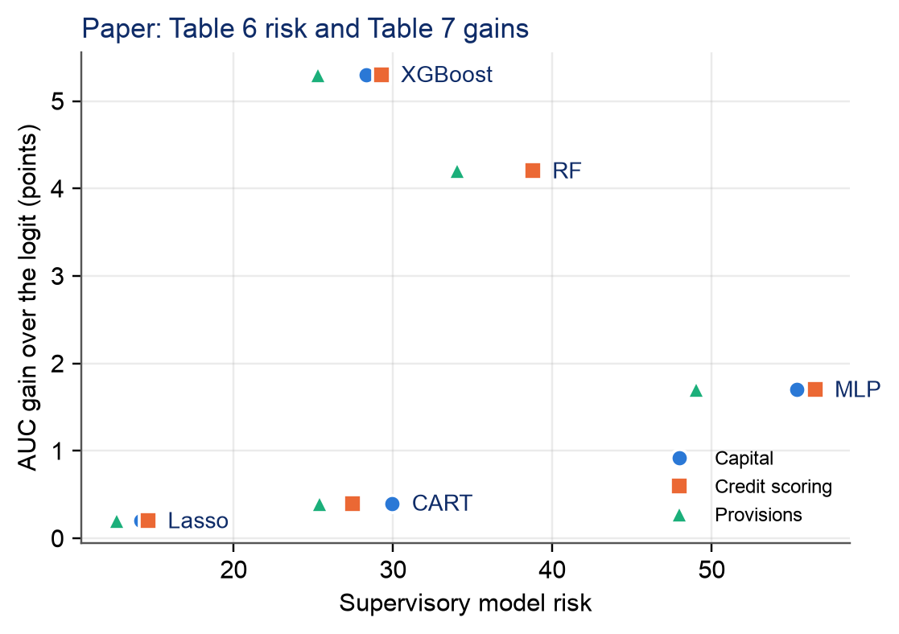
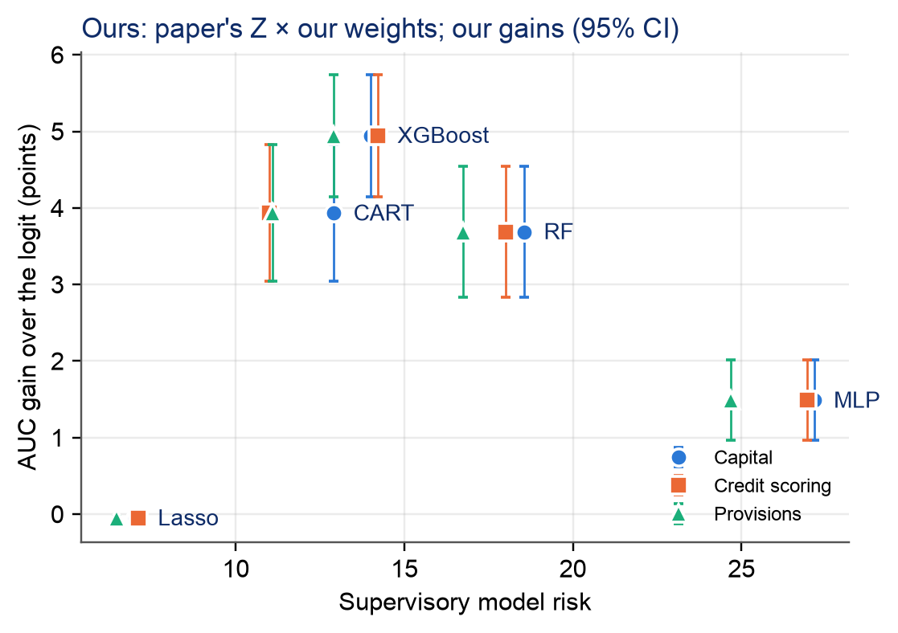

# Model Risk-Adjusted Performance of ML in Credit Default Prediction

**Contributors:** Group 8: Nazarov, Doroshenko, Burlakov, Daunov, Sergeev

A replication of Alonso Robisco and Carbó Martínez, *Measuring the model risk-adjusted performance of machine learning algorithms in credit default prediction* (Financial Innovation 8:70, 2022), for the HSE Research Seminar. The assignment for this paper: **reproduce every result it lists and propose an improvement for each.**

The paper scores five credit-default models (Lasso, CART, random forest, XGBoost, a multilayer perceptron) for the model risk a bank supervisor would see. Phase 1 gives each model a "darkness" score from 1 to 5 in three risk categories (statistics, technology, market conduct), from five measured proxies and the authors' judgement. Phase 2 weights the categories for three uses of the model (regulatory capital, credit scoring, provisions) by how often the category's terms appear in regulatory texts. Risk is then set against the AUC gain over a logistic regression.

We rebuild both phases from scratch: the six models on Kaggle's Give Me Some Credit with the paper's settings, the five proxies, and the term counts on 35 of the 36 regulatory documents the paper lists. We check the paper's own arithmetic, and we add one pre-registered improvement per result: uncertainty for every number, multiple-testing corrections, a common explainer for SHAP, a rule instead of expert scores, and the same protocol on two more datasets.

- Presentation: [docs/presentation.pptx](docs/presentation.pptx) ([PDF](docs/presentation.pdf)); what to say on each slide and likely questions: [docs/speaker_script.pdf](docs/speaker_script.pdf).
- Every departure from the paper and every decision where it is silent: [DEVIATIONS.md](DEVIATIONS.md).
- Verdict rules and improvements, fixed before they were run: [docs/preregistration.md](docs/preregistration.md).
- The paper (CC BY 4.0): [paper/alonso_carbo_2022.pdf](paper/alonso_carbo_2022.pdf).

## How to run

Python 3.13 on macOS (Apple silicon); XGBoost needs the OpenMP runtime (`brew install libomp`).

```bash
python3.13 -m venv .venv && source .venv/bin/activate
pip install -e . -r requirements.txt
pytest -q
python scripts/download_data.py        # needs ~/.kaggle/kaggle.json and the GiveMeSomeCredit rules accepted on kaggle.com
python scripts/download_corpus.py      # the regulatory PDFs listed in data/corpus_manifest.csv
python scripts/extract_paper.py        # Table 11 and the values behind Figs. 1 and 5, from the paper's PDF
python scripts/reproduce_models.py     # Tables 5 and 7, Figs. 6-8 (~25 min on 14 cores)
python scripts/reproduce_nlp.py        # Tables 2, 3, 8-10
python scripts/reproduce_scorecard.py  # Tables 4 and 6, Fig. 5, errata
python scripts/improve_nlp.py          # I2-I6
python scripts/improve_models.py       # I1, I7, I11, I12
python scripts/improve_risk.py         # I13
python scripts/make_report.py          # this README's results section and results/report/key_numbers.json
python scripts/make_slides.py          # docs/presentation.pptx
python scripts/make_speaker_script.py  # docs/speaker_script.pdf
```

Data are not committed: Kaggle's licence forbids redistribution, and the regulatory texts belong to their publishers. `data/corpus_manifest.csv` lists every document's source URL, version and SHA-256.

## Results

<!-- results:start -->
<!-- Generated by scripts/make_report.py from results/. Do not edit by hand. -->

### Data and setup (ours)

Give Me Some Credit: 150,000 rows in `cs-training.csv`, of which 120,269 complete cases (the paper: 120,000); default rate 6.95%. 20 features (10 characteristics and their squares). Stratified 80/20 split: 96,215 training and 24,054 test rows. Lasso penalty chosen by 5-fold CV on the training rows: C = 10. Timings on Apple M5 Pro, macOS-26.6.2-arm64-arm-64bit-Mach-O, Python 3.13.15.

**What is fitted, chosen and evaluated.** Each model is fitted to the training rows by its own loss (log-loss for the logit, Lasso, MLP and XGBoost; Gini impurity for the trees). Only the Lasso penalty is chosen (5-fold cross-validated AUC on the training rows); every other hyperparameter is the paper's. Everything is evaluated on the test rows. The darkness scores Z are the paper's expert judgement; nothing in phase 2 is fitted.

### Prediction (Table 7)

**Paper** (its data and split):

| Model | AUC (%) | 95% interval | Gain over logit (points) |
|---|---|---|---|
| Logit | 80.0 | [79.3, 80.7] | – |
| Lasso | 80.2 | [79.6, 80.8] | +0.2 |
| CART | 80.4 | [79.7, 81.2] | +0.4 |
| RF | 84.2 | [83.7, 84.8] | +4.2 |
| XGBoost | 85.3 | [84.8, 85.8] | +5.3 |
| MLP | 81.7 | [81.0, 82.3] | +1.7 |

**Ours** (± DeLong standard error; the gain test is paired, on the same test rows):

| Model | AUC (%, ± s.e.) | 95% interval | Gain over logit (points, paired DeLong) |
|---|---|---|---|
| Logit | 80.5 ± 0.6 | [79.3, 81.7] | – |
| Lasso | 80.5 ± 0.6 | [79.2, 81.7] | -0.05 ± 0.01 (p < 0.001) |
| CART | 84.4 ± 0.5 | [83.4, 85.5] | +3.93 ± 0.45 (p < 0.001) |
| RF | 84.2 ± 0.5 | [83.2, 85.2] | +3.69 ± 0.44 (p < 0.001) |
| XGBoost | 85.4 ± 0.5 | [84.5, 86.4] | +4.95 ± 0.41 (p < 0.001) |
| MLP | 82.0 ± 0.6 | [80.8, 83.2] | +1.49 ± 0.27 (p < 0.001) |

**Why our CART is far above the paper's.** On the validation rows a depth-7 tree scores 84.7; depth 3 gives 81.4, depth 11 76.4, an unpruned tree 60.1; scoring depth 7 by hard labels gives 56.6. No setting at the paper's depth gives 80.4, so the paper's tree probably differs from what it reports (`scripts/diagnose_cart.py`, validation rows only).

### Model-risk proxies (Table 5)

**Paper:**

| Model | SD of AUC | Hyperparameters | Training (s) | Transparency | SHAP (s) | Z: stat. / tech. / conduct |
|---|---|---|---|---|---|---|
| Lasso | 0.001 | 0 | 3.92 | 1 | 0 | 1 / 1 / 1 |
| CART | 0.005 | 1 | 0.67 | 2 | 0 | 3 / 1 / 1 |
| RF | 0.003 | 2 | 19.25 | 3 | 60 | 3 / 3 / 2 |
| XGBoost | 0.001 | 2 | 1.29 | 3 | 8 | 2 / 2 / 2 |
| MLP | 0.002 | 5 | 31.42 | 5 | 2000 | 5 / 5 / 3 |

**Ours** (SD over 100 retrains on 60–100% subsamples, bootstrap s.e.; times single-threaded, median of 5 fits after a warm-up; SHAP for 1,000 test rows):

| Model | SD of AUC (± s.e.) | Fitted parameters | Training (s), median [IQR] | SHAP (s), default explainer | SHAP (s), one explainer |
|---|---|---|---|---|---|
| Lasso | 0.0006 ± 0.0000 | 21 | 25.55 [25.48, 25.88] | 4.3 | 4.3 |
| CART | 0.0038 ± 0.0002 | 243 | 0.29 [0.29, 0.30] | 0.0 | 3.1 |
| RF | 0.0019 ± 0.0001 | 856,606 | 9.02 [8.97, 9.05] | 67.0 | 171.4 |
| XGBoost | 0.0014 ± 0.0001 | 2,194 | 0.15 [0.15, 0.15] | 0.0 | 9.0 |
| MLP | 0.0033 ± 0.0003 | 86,701 | 6.54 [5.97, 8.06] | 29.4 | 29.5 |

### SHAP feature rankings (Figs. 6–8)

**Paper** (top four, read from the figures):

| Rank | RF (Fig. 6) | XGBoost (Fig. 7) | MLP (Fig. 8) |
|---|---|---|---|
| 1 | 90+ days late | Revolving utilisation | 30–59 days |
| 2 | 30–59 days | 30–59 days | 90+ days late |
| 3 | 60–89 days | 90+ days late | 60–89 days |
| 4 | age | age | age |

**Ours** (mean |SHAP| per characteristic, x and x² summed; each library's default explainer):

| Rank | RF | XGBoost | MLP |
|---|---|---|---|
| 1 | Revolving utilisation | Revolving utilisation | 30–59 days |
| 2 | 90+ days late | 30–59 days | 90+ days late |
| 3 | 30–59 days | 90+ days late | age |
| 4 | 60–89 days | age | 60–89 days |

### Weights from regulatory texts (Table 2, Fig. 3)

Our corpus: 12 capital, 5 credit-scoring, 7 provisioning and 10 common-area documents (1,139,972 words); missing: prov_03_ifrs_pwc. Sources, versions and hashes: `data/corpus_manifest.csv`.

**Paper** (percent of all words):

| Use | Statistics | Technology | Market conduct | Total |
|---|---|---|---|---|
| Capital | 7.90 | 2.50 | 3.75 | 14.15 |
| Credit scoring | 6.41 | 3.09 | 5.13 | 14.63 |
| Provisions | 6.38 | 2.36 | 3.90 | 12.64 |

**Ours** (percent of all words, ± document-bootstrap s.e.):

| Use | Statistics | Technology | Market conduct | Total |
|---|---|---|---|---|
| Capital | 2.95 ± 0.48 | 1.60 ± 0.46 | 2.45 ± 0.29 | 7.00 ± 0.53 |
| Credit scoring | 1.95 ± 0.45 | 1.85 ± 0.48 | 3.31 ± 0.33 | 7.11 ± 0.58 |
| Provisions | 2.32 ± 0.48 | 1.50 ± 0.46 | 2.63 ± 0.30 | 6.45 ± 0.49 |


**Why our levels are about half the paper's.** Every ordering matches, but our shares are roughly half. If the denominator excludes English stop words (a step the paper does not mention; 42% of our tokens), the totals become 11.7% / 11.9% / 10.7% (paper 14.2% / 14.6% / 12.6%) and the share of negative words 3.77% / 2.90% / 4.55% (paper 3.87% / 3.09% / 4.88%). So the paper most likely divided by non-stop-words. Our main results keep all words, as the paper's text describes (`scripts/diagnose_nlp_levels.py`).

Mentions per document (p. 11). Paper: stability 6.4, feature engineering 0.33, hyperparameters 0.2, overfitting 0.16, dynamic calibration 0.02. Ours: stability 7.53, feature engineering 0.29, hyperparameters 0.21, overfitting 0.26, dynamic calibration 0.00.

### Are the differences significant? (Table 3)

**Paper** (p-values; * marked significant at 10%):

| Uses | Statistics | Technology | Market conduct |
|---|---|---|---|
| capital vs scoring | 0.0181 * | 0.1897 | 0.0030 * |
| capital vs provisions | 0.0133 * | 0.0180 * | 0.5618 |
| scoring vs provisions | 0.9404 | 0.1097 * | 0.0128 * |

**Ours** (Welch t-test p-values; * below 0.10):

| Uses | Statistics | Technology | Market conduct |
|---|---|---|---|
| capital vs scoring | 0.0004 * | 0.2538 | 0.0103 * |
| capital vs provisions | 0.0355 * | 0.0089 * | 0.3456 |
| scoring vs provisions | 0.1347 | 0.1379 | 0.0310 * |

### Sentiment robustness (Tables 8 and 10)

**Paper** (negative words within 10 words of a mention, per mention):

| Use | Statistics | Technology | Market conduct | Negative words, all text |
|---|---|---|---|---|
| Capital | 0.79 | 0.59 | 0.78 | 3.87% |
| Credit scoring | 0.93 | 1.06 | 0.95 | 3.09% |
| Provisions | 0.89 | 0.42 | 0.75 | 4.88% |

**Ours:**

| Use | Statistics | Technology | Market conduct | Negative words, all text |
|---|---|---|---|---|
| Capital | 0.50 | 0.51 | 0.51 | 2.15% |
| Credit scoring | 0.49 | 0.43 | 0.48 | 1.69% |
| Provisions | 0.60 | 0.32 | 0.67 | 2.63% |


 

### Verdicts

Rules from `docs/preregistration.md`: *reproduced* if the paper's value is inside our 95% interval (or, for an ordering, our point estimates give the same order); *close* if it is outside but the conclusion drawn from it holds; *not reproduced* if the conclusion does not hold; *not testable* if the paper gives too little to recompute it.

| # | Paper's result | What we find | Verdict |
|---|---|---|---|
| R1 | Literature: gains up to 20%, not monotone in complexity (Fig. 1) | max 19.9% in the figure's data; class medians 6.0 / 8.0 / 4.9 / 4.8% | reproduced |
| R2 | "Stability" mentioned 6.4 times per document, others ≤ 0.33 (p. 11) | 7.5 vs at most 0.29 | reproduced |
| R3 | Weights: statistics → capital; technology and conduct → scoring; provisions lowest (Table 2) | 4 of 4 hold; levels about half (totals 7.0 / 7.1 / 6.5%) | reproduced |
| R4 | Six of nine use differences significant at 10% (Table 3) | 5 of 9 significant; agree with the paper on 8 of 9 | reproduced |
| R5 | Sentiment: technology and conduct terms most negative in scoring texts (Tables 8-10) | technology no, conduct no (d = 10) | not reproduced |
| R6 | Worked example: riskiness 0.523 / 0.554 / 0.536 (Table 4) | with the paper's weights: 0.5237 / 0.5546 / 0.5364 | reproduced |
| R7 | Stability: Lasso, XGBoost most stable; CART, MLP least (Table 5) | order of SD(AUC): Lasso < XGBoost < RF < MLP < CART | reproduced |
| R8 | Hyperparameters: Lasso 0, CART 1, RF 2, XGBoost 2, MLP 5+ (Table 5) | a definition, taken as stated | not testable |
| R9 | Training time: CART < XGBoost < Lasso < RF < MLP (Table 5) | XGBoost < CART < MLP < RF < Lasso | not reproduced |
| R10 | SHAP time: XGBoost 8 s < RF 60 s < MLP 2,000 s (Table 5) | XGBoost 0.0 s < MLP 29.4 s < RF 67.0 s | not reproduced |
| R11 | SHAP: late payments top 3; revolving first only for XGBoost; age 4th (Figs. 6-8) | 1 of 3 statements hold | not reproduced |
| R12 | AUC: logit 80.0 to XGBoost 85.3; XGBoost best (Table 7) | 5 of 6 paper AUCs inside our 95% intervals; best: XGBoost | reproduced |
| R13 | Risk-reward: XGBoost most risk-efficient; provisions least risky use (Table 6, Fig. 5) | frontier: Lasso, CART, XGBoost; provisions least risky for 4 of 5 models | close |

### Errata: the paper against itself

Found by `scripts/reproduce_scorecard.py` from the paper's own numbers (no data of ours involved).

| # | Where | Inconsistency |
|---|---|---|
| E1 | Table 5 vs Table 6 (pp. 18, 20) | MLP statistics score is 5 in Table 5 and the text but 4 in Table 6 |
| E2 | Fig. 5 vs Table 6 (pp. 20, 22) | Random forest points in Fig. 5 match a statistics score of 2, not the 3 of Tables 5 and 6 |
| E3 | Text vs Table 6 (p. 20) | The text says CART is less risky than XGBoost for provisioning; Table 6 says the opposite |
| E4 | Table 3 (p. 16) | p = 0.1097 (scoring vs provisions, technology) is marked significant at 10% |
| E5 | Text vs Table 5 (p. 18) | Text names CART and MLP as least stable; Table 5's two largest SDs are CART and RF |
| E6 | p. 17 vs Figs. 6-8 | Text: 11 characteristics and 22 variables with squares; the data have 10 characteristics (11 columns with the file's row index) and the SHAP figures show 10 features |
| E7 | p. 13 vs Table 11 | statistics: 54 terms stated, 53 listed |
| E8 | Table 12 vs Fig. 9 | Fig. 9 counts the EBA report on innovative uses of consumer data in the common area (Table 12: credit scoring) and has no bar for IIF (2018), which Table 12 lists |

### Improvements, one per result

Pre-registered in `docs/preregistration.md` before they were run.

| # | Improvement | Finding |
|---|---|---|
| I1 | Same-protocol benchmark on three datasets with paired DeLong intervals | GMSC: best XGBoost (vs CART, p < 0.001); Taiwan: best XGBoost (vs RF, p = 0.678); German (1,000 loans): best MLP (vs Lasso, p = 0.983). Spearman(complexity, gain): GMSC +0.21, Taiwan +0.67, German +0.36 |
| I2 | Bootstrap intervals for the mentions per document | stability 7.53 [4.00, 11.38] per document; 44% of all mentions in the top three documents |
| I3 | Document bootstrap of the weights; dictionary audit | statistics highest for capital: P = 0.98; technology highest for scoring: P = 0.95; conduct highest for scoring: P = 1.00; provisions lowest total: P = 0.91. Terms above 10% of their category: Model (41% of statistics), Management (23% of conduct), ICT (22% of technology), Development (16% of technology), Security (14% of technology), Consumers (10% of conduct) |
| I4 | Permutation tests, Holm and Benjamini–Hochberg over nine tests | 5 of 9 below 10% (Welch); after Holm: 2 at 10%, 1 at 5%; after BH: 7 at 10% |
| I5 | Negative words relative to the base rate (lift), bootstrap | P(scoring has the highest lift): technology 0.54, conduct 0.71 |
| I6 | Worked example with weight uncertainty | 0.561 ± 0.021 / 0.597 ± 0.021 / 0.575 ± 0.023; P(scoring riskiest) = 1.00 |
| I7 | Both stability definitions, paired bootstrap | P(Lasso and XGBoost more stable than CART and MLP): AUC spread 1.00, PD spread 1.00 |
| I8 | Fitted parameters instead of a hyperparameter count | Lasso 21; CART 243; RF 856,606; XGBoost 2,194; MLP 86,701 (Spearman with the paper's count +0.82) |
| I9 | Timing hygiene: single thread, warm-up, median and IQR; relative to the logit | XGBoost ×3; CART ×6; MLP ×132; RF ×182; Lasso ×516 |
| I10 | One SHAP explainer and scale for every model | CART 3 s; Lasso 4 s; XGBoost 9 s; MLP 29 s; RF 171 s |
| I11 | SHAP rankings on the probability scale, five seeds | seeds where the claim holds, default explainer → probability scale: late payments in the top three 5→4 of 5; revolving utilisation first only for XGBoost 0→0 of 5; age fourth 0→0 of 5 |
| I12 | Calibration next to AUC (Brier, ECE, slope) | best Brier: XGBoost; Spearman(AUC, −Brier) = +0.77; Lasso slope 1.05; CART slope 0.89; RF slope 0.85; XGBoost slope 0.97; MLP slope 0.93 |
| I13 | Rule-based Z and Monte Carlo over all inputs | P(on the frontier, worst use): Lasso 0.00; CART 0.01; RF 0.00; XGBoost 1.00; MLP 0.00. P(highest gain): XGBoost 1.00. On the normalised scale, provisions is the least risky use for 0 of 5 models: the paper's ordering of uses comes from provisioning texts using fewer risk terms overall |

<!-- results:end -->
